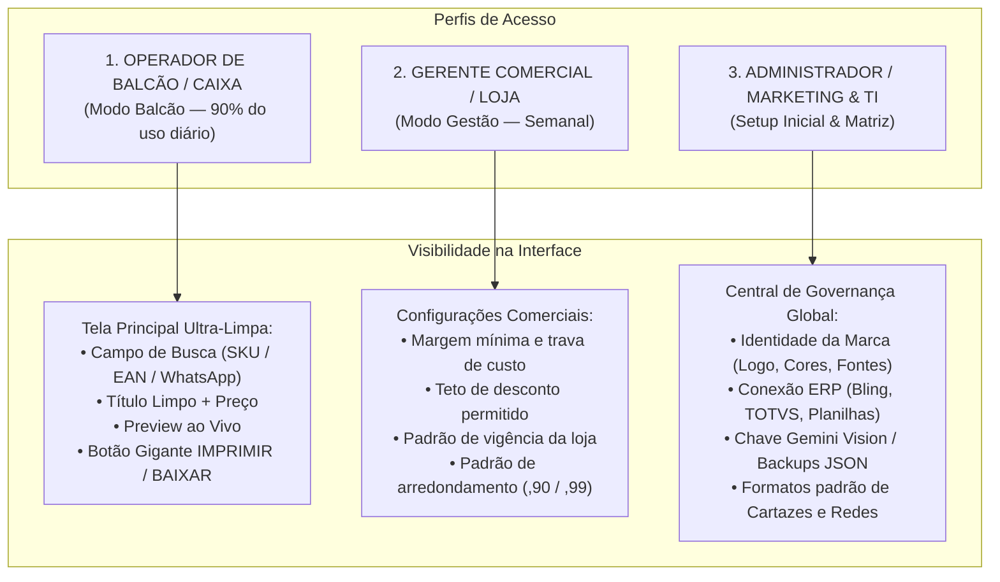

# PLANO MESTRE: DESPOLUIÇÃO VISUAL & ARQUITETURA DE PERFIS (FIM DO "PAINEL DE AVIÃO")
**Projeto:** Studio Varejo & Agro Pro  
**Status Atual:** Produção (Online na Vercel)  
**Diagnóstico:** "Painel de Avião" — saturação visual por excesso de controles simultâneos no fluxo de trabalho diário.  
**Premissa Central:** **Visível apenas o essencial para o operador diário**; tudo o que é quantitativo, parametrização ou decisão estratégica vai para a **Central de Configurações da Loja**.

---

## 1. O Diagnóstico: Por que o Painel Parece um "Cockpit de Avião"?

Atualmente, na tela principal, um operador de balcão ou caixa que deseja apenas imprimir uma etiqueta se depara simultaneamente com:
1. **Exemplos de uso em botões clicáveis** poluindo a barra do Smart Paste.
2. **Toggle manual de Lote vs Individual**.
3. **Dropdown de Título da Etiqueta** (`OFERTA`, `PROMOÇÃO`, `SUPER PREÇO`).
4. **Grid de 8 botões de mecânicas comerciais** + sub-painéis condicionais de parcelas, brindes e dias de vencimento.
5. **Chips de SKUs de demonstração** (`#101 Ração`, `#201 Máquina`, etc.).
6. **Contador de caracteres** + botão manual `Limpar Siglas`.
7. **Subtítulo / Linha de apoio**.
8. **Grid de 4 botões de arredondamento psicológico**.
9. **Grid de 5 botões de vigência PROCON**.
10. **Acordeon do Gerente** com preço de custo, categoria MAPA, 3 proporções sociais, 4 temas visuais e 2 checkboxes de guias.
11. **Coluna de Preview sobrecarregada no topo** com 4 botões de arquétipos + 3 botões de cores + 3 botões de formato de folha.

> **Conclusão:** 80% desses elementos são decisões que a matriz, o marketing ou a gerência tomam **uma única vez** ou revisam semanalmente. Exibi-los para o operador de caixa em cada emissão gera lentidão, insegurança e poluição visual.

---

## 2. A Matriz de Perfis e Níveis de Acesso (RBAC Ágil)

Propomos estruturar a experiência em **3 Modos de Operação**:



### Detalhamento dos Perfis:

| Perfil | Quem é? | O que precisa fazer? | O que vê na tela? |
| :--- | :--- | :--- | :--- |
| **Operador de Balcão / Caixa** | Atendente, caixa, repositor | Emitir cartaz em menos de 10s sem errar | **Zero ajustes de design.** Apenas busca SKU ou cola do WhatsApp, confere o preço e clica em Imprimir. |
| **Gerente Comercial** | Gerente de loja, comprador | Definir políticas comerciais da semana | Painel de regras: margem mínima, limite de desconto, parcelamento padrão (ex: até 10x sem juros), vigência padrão da loja. |
| **Administrador / Marketing & TI** | Dono da rede, analista de marketing, TI | Garantir padronização visual e integração | Configuração de Marca White-Label, logotipo, departamentos, conexão ERP/planilha, token de IA e backup geral. |

---

## 3. Mapeamento Módulo a Módulo: O que Fica vs O que vai para Configurações

### Módulo 1: Cartazes de Loja (Impressão A4 / A5 / Gôndola)
- **FICA NA TELA DO OPERADOR (Essencial Máximo):**
  - Campo único inteligente: digita código SKU/EAN ou cola texto do WhatsApp.
  - Título do produto (já auto-sanitizado sem siglas).
  - Preço DE (opcional) e Preço POR (com cálculo automático de centavos).
  - Preview ao vivo da folha de impressão.
  - Botão de ação: `🖨️ IMPRIMIR FOLHA` (ou `Ctrl+P`).
- **DESCE PARA CONFIGURAÇÕES (Feito pelo Gerente / Admin):**
  - Formato padrão da folha (se a loja imprime sempre A4, A5 ou Gôndola 2x2, fica salvo como padrão).
  - Tema visual padrão (Toner P&B para laser ou Colorido institucional).
  - Seletor de Arquétipo: o sistema escolhe automaticamente via `resolveRecommendedArchetype`. Só mexe em configurações se quiser forçar outro layout.
  - Título da Etiqueta padrão (`OFERTA`, `PROMOÇÃO`, etc.).
  - Arredondamento padrão da loja (ex: rede opera com terminação `,90`).
  - Vigência padrão da loja (ex: `Até Sábado`).

### Módulo 2: Redes Sociais (Feed, Story & Quadrado)
- **FICA NA TELA DO OPERADOR:**
  - Envio/Troca de foto do produto (com o auto-recorte já embutido).
  - Campo de CTA rápido (ex: `PEÇA NO WHATSAPP`).
  - Preview ao vivo no formato ativo.
  - Botões de exportação: `⬇️ BAIXAR PNG (1080P)` e `📲 COMPARTILHAR WHATSAPP`.
- **DESCE PARA CONFIGURAÇÕES:**
  - Proporção padrão (Story 9:16 vs Feed 4:5).
  - Telefone WhatsApp e filial padrão da loja.
  - Guia de zonas seguras e inclusão ou não do bloco de diferenciais.

### Módulo 3: Carrossel Guiado (Feed 4:5)
- **FICA NA TELA DO OPERADOR:**
  - Botão de 1 clique: `⚡ Gerar Carrossel da Base ERP`.
  - Navegação fluida entre os slides (Slide 1, 2, 3...) com preview instantâneo.
  - Botão de download dos slides.
- **DESCE PARA CONFIGURAÇÕES:**
  - Quantidade padrão de slides por carrossel (ex: padrão 3 slides).
  - Chamada final padrão da matriz e contato comercial.

### Módulo 4: RH, Vagas & Comunicados Internos
- **FICA NA TELA DO OPERADOR:**
  - Seletor rápido de tipo: `💼 Vaga` / `📋 Comunicado` / `🦺 Segurança EPI`.
  - Campos diretos: Cargo/Assunto, local/horário e canal de envio.
  - Botão de imprimir/baixar.
- **DESCE PARA CONFIGURAÇÕES:**
  - Cabeçalho institucional fixo da empresa.
  - Canal de contato padrão do setor de RH da matriz.

### Módulo 5: Base de Dados ERP & Integrações
- **DESCE INTEGRALMENTE PARA CONFIGURAÇÕES DE TI / ADMIN:**
  - Importação de planilhas CSV/TSV e JSON.
  - Sincronização automática via URL/Google Sheets.
  - Painel do Contrato da API Headless Enterprise (`POST /api/v1/render`).
  - O operador na tela diária apenas enxerga o campo de busca de SKU que consome essa base de dados de forma transparente.

---

## 4. Limpeza de Exemplos de Uso e Microcópia Poluidora

Conforme diretriz aprovada:
1. **Remoção de Chips de Exemplo da Tela:**
   - Todos os botões como `"Ração Tutticanis 10.1kg de 58,00 por 44,00"`, `"Herbicida Glifosato..."`, etc., serão **removidos do layout da página**.
2. **Migração para o Ícone de Ajuda (`HelpHint` `?`):**
   - Ao passar o mouse (ou focar via teclado) no `?` ao lado de cada campo, o tooltip exibirá de forma elegante:
     - O objetivo do campo.
     - Exemplos reais de digitação.
     - Atalho de teclado correspondente.
3. **Eventos Chapados / Padrões Nativos:**
   - Títulos de campos concisos e limpos (ex: `PRODUTO`, `PREÇO`, `CÓDIGO`).
   - Eliminação de botões soltos como `Limpar Siglas` (a higienização ocorrerá automaticamente no evento `onBlur`).

---

## 5. A Nova Arquitetura de Configurações: A Central Única da Loja

Em vez de vários botões dispersos no cabeçalho e na página (`⚙ Marca`, `🔌 Base ERP`, `🎨 Opções do Gerente`, etc.), unificaremos tudo em um único ponto de entrada elegante no cabeçalho:

### `⚙️ Configurações & Governança da Loja`
Um modal moderno com navegação lateral por abas, permitindo configurar a loja em minutos:

```
+---------------------------------------------------------------------------------+
|  ⚙️ CENTRAL DE CONFIGURAÇÕES & GOVERNANÇA DA LOJA                        [✕]   |
+-------------------+-------------------------------------------------------------+
| 🏢 Identidade     | • Nome da Empresa e Filial Padrão                           |
|    & White-Label  | • Upload de Logotipo Oficial com Recorte Transparente       |
|                   | • Cores Primária, Secundária e Destaque (com WCAG 2.1)      |
|                   | • Par Tipográfico Homologado (Montserrat, Oswald, etc.)    |
|                   | • Submarcas / Departamentos da Rede                         |
+-------------------+-------------------------------------------------------------+
| ⚖️ Regras         | • Margem de Lucro Mínima (Bloqueio anti-prejuízo)          |
|    Comerciais     | • Teto de Desconto Máximo antes de exigir aprovação         |
|    & MAPA         | • Padrão de Vigência da Loja (ex: Até Sábado)               |
|                   | • Padrão de Arredondamento Comercial (ex: Final ,90)        |
|                   | • Registro do Responsável Técnico / MAPA                    |
+-------------------+-------------------------------------------------------------+
| 🖨️ Padrões de    | • Formato Padrão da Folha (A4 Cheio / A5 Meia / Gôndola 2x2)|
|    Cartazes       | • Tecnologia de Impressão Padrão (Toner P&B vs Colorida)    |
|                   | • Selo % OFF (Sempre Ativo / Sob Demanda)                   |
|                   | • Título de Etiqueta Padrão da Loja                         |
+-------------------+-------------------------------------------------------------+
| 📱 Redes Sociais  | • Proporção Padrão (Story 9:16 vs Feed 4:5)                 |
|    & Carrossel    | • Telefone WhatsApp Padrão para os CTAs                     |
|                   | • Quantidade Padrão de Produtos por Carrossel               |
+-------------------+-------------------------------------------------------------+
| 🔌 Conexão ERP    | • Importador de Planilha de Produtos (CSV / Excel / JSON)   |
|    & Sistema      | • URL de Sincronização Automática (Google Sheets / API)     |
|                   | • Chave de Visão Gemini Flash (Opcional)                    |
|                   | • Backup Completo da Loja (.json) e Contrato API Headless   |
+-------------------+-------------------------------------------------------------+
| 👤 Modo de Acesso | • Alternar entre:                                           |
|                   |   [●] Modo Balcão (Operador: interface ultra-resumida)      |
|                   |   [ ] Modo Gerente (Exibe parâmetros de ajuste fino)        |
+-------------------+-------------------------------------------------------------+
```

---

## 6. Roteiro de Implementação Proposto (Etapas Seguras)

Para avançarmos com segurança técnica (zero regressão, validação real com `npm test`, `npx tsc` e `npx vite build`):

1. **Etapa 1 — Criação da Central de Configurações Unificada (`StoreSettingsModal.tsx`):**
   - Consolidar as funcionalidades de `BrandKitModal.tsx`, `ErpIntegrationModal.tsx` e as opções dispersas de `App.tsx` em um único componente com navegação limpa por abas.
2. **Etapa 2 — Limpeza Radical da Coluna Esquerda de `App.tsx` (Fluxo Operador):**
   - Remover os chips de exemplos do Smart Paste.
   - Remover o dropdown manual de "Título da Etiqueta" e o botão "Limpar Siglas" (tornar 100% automático no `onBlur`).
   - Compactar mecânicas comerciais e esconder campos não essenciais no modo Balcão.
3. **Etapa 3 — Despoluição da Coluna Direita (Preview):**
   - Remover os seletores de arquétipo duplicados do topo do preview (o motor determina o melhor layout automaticamente).
   - Manter apenas o preview limpo e os botões grandes de impressão/exportação.
4. **Etapa 4 — Adição do Toggle de Perfil no Topo:**
   - Adicionar chave discreta no cabeçalho: `Modo Balcão` (Foco) vs `Modo Gerente` (Avançado).
5. **Etapa 5 — Validação, Testes Automatizados e Deploy Git:**
   - Executar `npm test`, `npx tsc --noEmit`, `npx vite build`, atualizar `CHANGELOG.md` e commitar.
