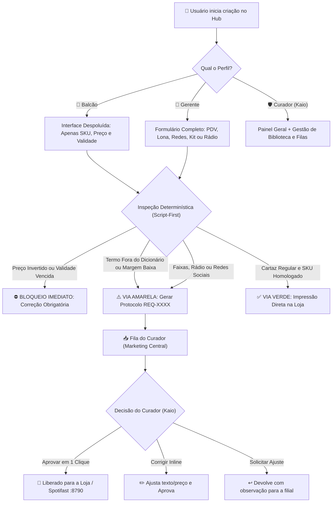

# MATRIZ DE PERMISSÕES, NÍVEIS DE ACESSO & FLUXO DE GOVERNANÇA — HUB COAGRO v3.3

**Responsável pelo Projeto & Curadoria:** Kaio Virgínio (Marketing Coagro)  
**Diretório Oficial:** `C:\RESOLVER\Hub Coagro`  
**Data:** 10 de Novembro de 2026  

---

## 1. Visão Geral dos Perfis de Usuário (RBAC)

O ecossistema do Hub Coagro opera em 3 níveis hierárquicos para garantir agilidade na ponta (lojas) com 100% de blindagem da identidade da marca:

| Nível de Acesso | Perfil | Descrição Operacional | Alçada de Exportação |
| :--- | :--- | :--- | :--- |
| **Nível 1** | **🛒 Balcão / Operador (`OPERATOR`)** | Vendedoras e operadores de loja nos terminais do PDV. Foco em cartazes de gôndola e balcão em menos de 10 segundos. | **Imediata (Via Verde)** para cartazes de produtos homologados sem desconto abusivo. Sem acesso a configurações globais. |
| **Nível 2** | **🏬 Gerente de Filial (`STORE_MANAGER`)** | 1 login por unidade (15 lojas Coagro, Coagro Pet e RB Agrícola). Submete demandas locais, kits de equipe e faixas de rua. | **Preview Travado + Solicitação**. Visualiza o mockup com marca d'água e gera protocolo `REQ-XXXX` para curadoria. |
| **Nível 3** | **🛡️ Curador Admin (`CURATOR_ADMIN`)** | Kaio Virgínio (Marketing Central). Visão de toda a rede, auditoria de dados e liberação final para gráficas/rádio. | **Alçada Total**. Aprova em 1 clique, edita inline, homologa termos no Dicionário Agro e exporta em alta resolução. |

---

## 2. Matriz de Acesso Módulo a Módulo

| Módulo do Sistema | Balcão (`OPERATOR`) | Gerente (`STORE_MANAGER`) | Curador (`CURATOR_ADMIN`) | Regra de Governança |
| :--- | :---: | :---: | :---: | :--- |
| **1. Cartazes PDV (Individual)** | ✅ Preço, SKU e Unidade | ✅ Dados completos e lote | ✅ Edição total + Alta Resolução | **Via Verde** (direto) se preço e margem válidos. |
| **1. Cartazes PDV (Lote por Planilha)** | ❌ Oculto (Despoluído) | ✅ Upload CSV / Tabloide | ✅ Upload, auditoria e lote | Gera múltiplos A4 em sequência. |
| **2. Faixas, Banners e Lonas** | ❌ Oculto | ✅ Preenche medidas e texto | ✅ Envia para cotação gráfica CMYK | **Via Amarela** (cotação obrigatória). |
| **3. Anúncios WhatsApp / Feed** | ❌ Oculto | ✅ Cria prévia com foto homologada | ✅ Aprova e gera PNG 1080px | **Via Amarela** para evitar distorção visual. |
| **4. Kit Colaborador (Assinatura/Cartão)** | ❌ Oculto | ✅ Solicita para equipe da filial | ✅ Homologa e gera PDF gráfico | Formato horizontal padrão Coagro. |
| **5. Spots Rádio Coagro** | ❌ Oculto | ✅ Solicita ofertas locais (15s/30s) | ✅ Pré-escuta MP3 e envia `:8790` | Publicação direta na Rádio Coagro. |
| **6. Campanhas & Media Library** | 👁️ Visualiza ativas | ⚡ Aplica pacote no estúdio | ➕ Cadastra produtos com foto PNG | Matriz homologada de SKUs. |
| **7. Dicionário Corporativo Agro** | ❌ Apenas correção automática | ⚠️ Alerta amarelo no formulário | ➕ Homologa novos termos/marcas | Whitelist de marcas, defensivos e cultivares. |
| **8. Fila de Curadoria Central** | ❌ Sem acesso | 👁️ Acompanha protocolo da loja | 🛠️ Painel com aprovação e CSV | Gestão centralizada das 15 lojas. |

---

## 3. Fluxo de Decisão e Governança (Script-First)

---

## 4. Otimizações Propostas para a Próxima Iteração

1. **Botão "Modo Black Friday" no Cabeçalho:**
   - Toggle rápido que troca a testeira padrão pelo selo oficial Black Friday Coagro (fundo escuro/dourado da marca).
   - Trava a paleta sem misturar o Agro com o Pet.
2. **Motor de Renderização em Lote por Planilha:**
   - Importador direto de CSV/Excel com saneamento automático de prefixos do ERP (`0000805-`).
   - Pré-cálculo geométrico das fontes para impressão instantânea de 50+ cartazes em PDF único.
3. **Assinatura de E-mail Panorâmica (Estilo Faixa Horizontal):**
   - Aproveitar o grid horizontal da faixa de lona para criar assinaturas de e-mail responsivas com foto, ramal, WhatsApp da filial e selos de campanha.
